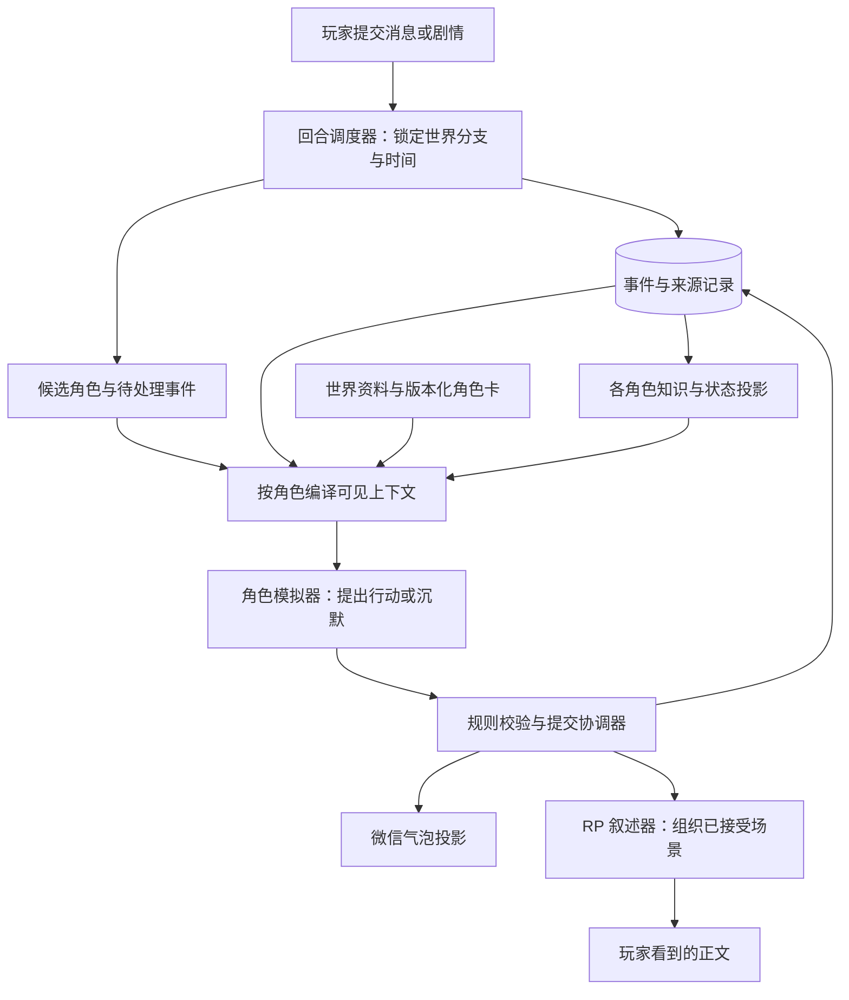

# RP-Hub 多角色世界重构方案

日期：2026-11-11。状态：**文本世界模式已实现并通过隔离测试；完整媒体、长期摘要与旧档迁移尚未完成。** 实际入口、已实现阶段、数据契约和验证见 [实现交接](./06-implementation-status.md)。01～05 保留原方案和实施前审计，不能当作当前缺口清单。

2026-11-12 本地界面、人物头像、重新编辑与保存提速见 [界面与保存交接](./08-world-ui-and-saving.md)。

本目录依据当前工作树、现有交接文档、苏祈雪 v2 与林晚角色卡整理。目的不是给现有 RP 再套一层聊天机器人，而是让同一个世界中的不同人物拥有连续的生活、独立的认知，以及可以互相影响的行动。

## 结论

建议把工程的运行单位从“当前角色卡的一段聊天”提升为“一个世界存档的一条分支”。世界保存事件；角色只能通过有效渠道获得其中的信息；RP 和微信展示同一条世界时间线的不同部分。

采用 **程序调度器＋按需角色模拟器＋RP 叙述器**。一个角色模拟器函数可以服务所有人物，每次调用绑定一个人物的卡、状态、关系和可见记忆。各人物可共用同一个模型和接口，不要求常驻 Agent、独立进程、不同模型或新的后端。

“每个人是一种工具”适合作为上层调用方式，但工具背后必须先有明确的数据边界。把全部卡和全部历史交给一个总模型，再让它自行决定谁知道什么，仍然会串记忆。上下文减少也不能保证没有幻觉；正确的信息组织、有限的生成权限和真实评测需要一起做。

## 用户已确认的边界

| 决策 | 本次确认 |
| --- | --- |
| 世界何时推进 | 只在玩家操作、提交剧情或明确推进剧情时间时推进；打开页面、刷新、浏览历史本身不推进 |
| 是否需要后台世界 | 不需要应用关闭后继续运行，也不按现实时间自动演化 |
| NPC 镜头 | 允许叙述玩家不在场的 NPC 场景；读者看到不等于玩家角色知道 |
| 世界设定基线 | 以苏祈雪 v2 的在校时间线为准；用户后续重构并提供适配卡 |
| 卿与玩家 | 卿是独立 NPC；林晚的恋人绑定到卿；玩家是另一个人 |
| 本次交付 | 用户已授权实施；文本世界、独立人物认知、群聊和 RP 调度已接入，具体范围及 P4 限制见实现交接 |

仍需在实际实施时确认的内容集中于 [实施与交接](./05-implementation-and-migration.md)，不会阻止先搭建不依赖具体卡文本的核心。

## 阅读顺序

| 文档 | 用途 |
| --- | --- |
| [现状与证据](./01-current-system-audit.md) | 目前已经有什么、缺什么、哪些文档与代码不一致 |
| [世界模型与角色认知](./02-world-model-and-knowledge.md) | 身份、分支、事件、信念、读消息与存储契约 |
| [调度与上下文](./03-orchestration-and-context.md) | 私聊、群聊、RP 的执行方式、工具、预算和失败恢复 |
| [场景与验收](./04-scenarios-and-evaluation.md) | 用生日惊喜等例子解释结果；给后续实现提供可检验标准 |
| [实施与迁移](./05-implementation-and-migration.md) | 改动接缝、阶段、旧存档处理、回退与下一位开发者入口 |
| [实际实现交接](./06-implementation-status.md) | 当前已实现范围、使用入口、存储、测试证据、限制与后续工作 |

## 建议系统结构

这里的“世界事件与知识”是业务数据，不是另一个大模型的长期聊天窗口。“总 Agent”中的大部分工作应由程序完成：分支隔离、工具权限、顺序、时间校验、重复请求处理、预算与落盘。遇到复杂的行动选择时才调用模型。

## 对原始设想的修正

1. **共享事件，不共享全部记忆。** 两条私聊可以改变同一个世界，但苏祈雪不会自动读到玩家与卿的秘密私聊。她仍可合理相信玩家去打球；卿知道约定已取消。这种不同认知是沉浸感的一部分。
2. **人物关系影响选择，不决定唯一选择。** “最好的朋友”不能推出林晚一定泄密。她可能保密、转移话题、先确认、意外说漏，也可能主动告知；必须结合当时动机和既有事实。
3. **位置不等于在线状态。** 在教学楼不能直接推出正在上课，更不能推出绝对不回微信。课程、手机可用性、注意力、人物习惯分别建模；未知就保留未知。
4. **群消息存在，不等于全员即时知情。** 消息发出、送达、读到、相信、回复是不同状态。没有回复也不等于没有读到。
5. **打算告知，不等于已经告知。** 只有实际告知事件发生并被接收，另一角色的知识才变化。不能把两个子模型讨论出的“可能”直接写成历史事实。
6. **叙述自由不能覆盖玩家选择。** NPC 可以独立行动，但邀请、问题和等待玩家决定的后果应停在回应点。

## 为什么不直接选择其他架构

| 方案 | 好处 | 主要问题 | 建议 |
| --- | --- | --- | --- |
| 一个模型读全部卡与世界历史 | 改动少，整体文风容易统一 | 私密信息都进入同一角色决策上下文；角色越多输入越大 | 可用作有限场景的对照基线，不作为长期核心 |
| 每个角色一个常驻聊天 Agent | 思路直观，看似各有记忆 | 分支、回档、升级卡、重复任务与同步难；上下文照样增长 | 不需要常驻实例，改为显式快照的按需调用 |
| 全 LLM 总导演调度所有步骤 | 灵活，适合探索原型 | 易预先替所有人决定剧情；每轮固定多一次调用 | 复杂场景规划时可选，不用于常规“哈喽” |
| 程序调度＋角色模拟＋受约束叙述 | 权限和因果可检验，逐步接入当前工程 | 需要先补事件、知识和迁移契约 | 推荐 |

## 第一块应该做什么

先完成 **苏祈雪、卿两条私聊 → 同一场 RP** 的窄闭环：卿不再等玩家打球，苏祈雪仍不知道惊喜。它能检验世界级身份、跨渠道事件、角色认知和上下文隔离，价值高于先做一个看起来热闹的群聊界面。

通过后再加群聊，最后扩展林晚主动告知等有限幕后传播。首次实施不同时重写整个 UI、引入新前端框架、接入向量数据库或建设实时后台。

本文档不承诺“完全消除幻觉”。程序可以严格检查身份、访问范围、因果引用、重复提交和时间边界；自然语言是否暗含泄密、是否符合人格，仍需要模型评测与人的判断。
