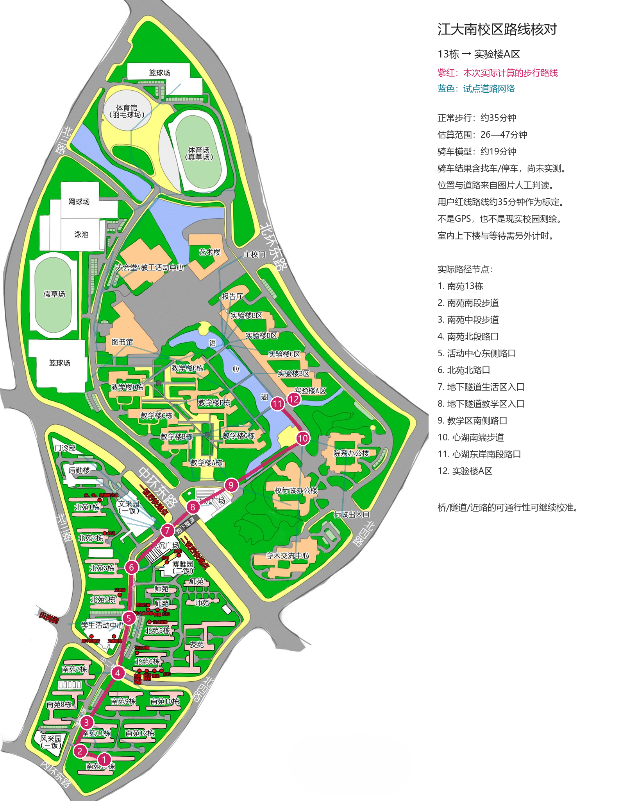

# 江大南校区地理能力试点交接

> 2026-11-06后续优化：RP/微信开放业务多调用，新增context/batch组合查询、自动本轮速查、brief/full与去重预算。费用与当前工具协议详见[地理工具与上下文优化](./geography-tools-cost.md)。用户已确认本项目不属于CWUI，保持原有界面风格。

日期：2026-11-06。目标工程：`D:\aiops_wwx\test\RP-Hub`。本次修改的是RP-Hub运行时和`card/suqixue`，聊天所在的`rp_card`工程不是运行时宿主。

## 已确认的产品口径

- 按用户确认，作为**虚构江南大学南校区的RP世界**：建筑位置以`card/江大南校区.jpeg`为依据，学校、院系和文化沿用角色设定。图片里的贝岗街、文采园等不是现实江南大学的校名证据。
- 用户明确确认：从南苑13栋沿附件红线到实验楼A区，正常行走**约35分钟**。这是用户校准的时间，图片没有比例尺。
- user住南苑13栋412，苏祈雪住北苑3栋314。住址不等于当前位置；只有明确在场/到达或用户手动设定才更新位置，“准备去”不会自动到达。
- 原卡13栋→实验楼A区12分钟与用户确认冲突，已移除；3栋→13栋14分钟未获得确认，也移除固定断言。其他旧分钟表不再作为事实使用。
- 情感与行动决策由角色模型根据人格、当前处境和实际行动成本决定。工具不硬编码“远就不来”或“恋爱就必须来”。

## 实际交付

1. 共享世界JSON：`worlds/jiangnan-south-campus.json`。目前71个地点/道路节点、72条连接，涵盖1—13栋、教学楼A—G、实验楼A—E、图书馆、食堂、生活/体育/行政区和校门。
2. 纯计算引擎：`assets/js/geography.js`。地点别名解析、歧义候选、图上道路寻路、步行/骑车时间区间、剧情时间的到达与门禁风险、保守位置证据重放。
3. 运行时接线：`assets/js/app/30-geography.js`。RP、微信共用`tool_geo`；绑定地图时自动提供，未绑定角色没有地理工具。
4. 重新生成`card/suqixue/苏祈雪.json`。七条旧地理世界书迁出，改为一条简短的共享世界能力说明；条目从23条变成17条。角色内核、日常与个人地点经历保留，私人地点记忆在角色扩展中独立保存。
5. 路线核对图：`docs/geography-pilot-route.png`。紫红线为**程序实际计算路径**，蓝线为试点道路网络，可与原附件核对。



## 设计判断与能力边界

“每次需要时让模型看地图”不能可靠解决问题。模型识图可能漏掉桥、入口和道路限制；没有比例尺就不能从像素得到真实米数。直接用两建筑的直线距离，会把湖、楼和围墙当成可穿越空间。

本实现将世界拆为三层：

- **世界资料**：地点功能、区域文化、季节环境、开放规则。跨角色共享，按地点查询；不是人物的履历。
- **道路网络**：节点、连接、允许交通方式、长度或图中折线。时间是程序计算结果，附来源与估算范围。
- **人物位置证据**：本分支明确自述/到达或用户设定的位置，附消息来源；角色住址、日程、未完成计划不自动充当位置。

角色模型接到短结果后自己判断要不要来、等多久、是否找车、是否先办完事情、如何表达情绪。工具里没有人格决策表。

**上下文不会变成零**：固定工具schema、短规则、最近位置证据、必要路线，以及真正查询的局部结果会占上下文。整张地图、整个校园世界书和图片像素不每轮注入。后续优化仅在本轮明确涉及地点/路程时自动准备短context，包含局部场景及步行/骑车时间；普通确认不附区域资料。后台计算不额外请求模型。

这次没有调用付费模型，也没有新模型API要求。路线计算本地执行；模型调用工具后续写可能增加一次正常聊天API请求。模型没有主动调用时也能利用本轮自动速查；主动查询依赖宿主和模型支持OpenAI兼容function calling，不承诺不支持tools字段的服务也能直接使用该请求体。其它宿主不加载此运行时，角色卡只能提供保守约束，不能假装拥有工具。

## 如何使用

1. 在RP-Hub刷新页面，并通过现有角色卡导入入口导入`card/suqixue/苏祈雪.json`。浏览器里此前导入的旧角色存储不会因为磁盘JSON改变而自动升级；重新导入会形成新角色，旧聊天记录保留在旧角色中。
2. 正常发言如“我在13栋，你能来吗？”；祈雪明确说“我在实验楼A区”后，下轮会带约35分钟的步行约束。只说“我在实验楼”会返回A—E候选，不能默认为A区。
3. 可在RP或微信由用户明确设定：

   ```text
   /geo user 13栋
   /geo character 实验楼A区
   /geo user unknown
   ```

   每条命令独占一条消息，使用`user`/`character`。这是一条保留在正常历史中的场景设定，仍会产生正常回复，不是隐藏控制台指令。模型自己发出`/geo`不会取得用户设定权限。
4. “我在宿舍”只在明确自述时根据该人的住址解析；“我准备回宿舍”不会修改当前位置。明确离开、在途中、否认在原地会使旧位置失效。
5. 复杂叙事中可以用用户`/geo`校正。为避免把计划、引用或NPC位置识别成角色位置，当前只解析有限的明确句式；支持角色全名开头的“苏祈雪来到…”，没有实现任意文学叙述的语义位置抽取。

不自动修改用户实际浏览器数据库、旧聊天和记忆。本次浏览器测试使用临时配置文件。

## 工具协议

单个`tool_geo`，允许字段：`operation/query/from/to/mode/weather/time/detail/requests`。优先context一次查齐；多地点用batch。详见后续费用优化交接。

```json
{"operation":"context","query":"风采园"}
{"operation":"search","query":"实验楼"}
{"operation":"place","query":"图书馆"}
{"operation":"status"}
{"operation":"route","from":"character","to":"user","mode":"walk"}
{"operation":"route","from":"实验楼A区","to":"13栋","mode":"bike","weather":"rain","time":"22:40"}
```

- `from/to`可以填写地点名、ID或`user/character`。人物位置未知时返回`needs_location`。
- 地点含糊时返回`ambiguous_place`与候选；没有地点返回`unknown_place`。无路返回`unreachable`；缺比例且道路未实测返回`uncalibrated`。
- 查询位置不会写位置。查询路线也不会推进剧情时钟或自动到达。
- `time`是剧情出发时间`HH:MM`，不会偷用电脑当前时间。返回到达区间与`dayOffset`。门禁/闭馆只是风险提示，没有保证一定可以进入。
- `place`返回地点功能、局部区域文化/感官、开放规则。个人地点记忆仅由当前角色的`placeMemories`补充，公共地图不包含祈雪的住址房间、私人物件或恋爱经历。
- 微信每轮最多4次地理调用，与图片、文档各自有界。结果本轮临时使用，正常时间线只保存最终角色回复。
- RP沿用原主动工具队列、最多5项业务调用/单批及现有自动续写上限；后续地理专用预算为每轮4次调用、成功资料合计12000字符。工具结果遵循原RP工具展示与持久化规则；可以在消息工具详情中查看，未单独写入长期记忆。

## 地图结构和更换方法

当前试点采用归一到`imageSize: [1097,2048]`的图片坐标：x向右、y向下，绘制核对图时先按该尺寸缩放原图。坐标点通常是入口/道路接点；主路设置折线转折防止穿楼/穿水。有多个地点共享建筑入口（例如图书馆一楼/四楼），程序只算楼外路程，**不会把零楼外距离说成零上下楼时间**。

最小地图示例：

```json
{
  "version": 1,
  "id": "my-world",
  "name": "新校园",
  "places": [
    {"id":"dorm","name":"宿舍","point":[0,0],"aliases":["寝室"],"function":"住宿"},
    {"id":"lab","name":"实验楼","point":[1,0],"function":"实验"}
  ],
  "edges": [
    {"id":"dorm-lab","from":"dorm","to":"lab","meters":1200,"provenance":"measured","modes":["walk","bike"]}
  ]
}
```

字段约定：

| 字段 | 用途 |
| --- | --- |
| `places[].id/name/aliases` | 稳定ID、正式名与别名；别名冲突保留歧义 |
| `places[].point` | 图中坐标；不直接证明真实米数 |
| `places[].function/scene/district/access` | 地点用途、感官/文化、区域和开放限制 |
| `districts/culture` | 公共区域背景与校园文化，避免混入某个角色的隐私经历 |
| `edges[].from/to/points` | 道路端点与中间折线；跨水连接必须显式建立 |
| `edges[].meters/provenance` | 优先用实测道路长度；只有`provenance: measured`且所有路径边实测才标为measured |
| `edges[].modes/oneWay/closed/note` | 可通行交通方式、单行、关闭与限制 |
| `edges[].bikeDismount` | 自行车必须下车推行，计入步行时间；本图隧道与下沉广场接路按此处理 |
| `metersPerUnit/calibration` | 图示折线比例和标定来源/误差；无标定不猜米数 |

添加/修改`worlds/*.json`后执行：

```powershell
node tools/geography/build-worlds.cjs
```

它验证地图并生成`assets/js/world-data.js`。本图`calibration.autoScale: true`，修改道路折线后会按指定的35分钟路线重新计算比例并更新源JSON；此模式不可混合实测边长。经典script静态加载，兼容原工程零构建与`file://`打开，不需要`fetch`本地JSON。不要手改生成文件。

角色卡只绑定共享世界与个人地点信息：

```json
{
  "data": {
    "extensions": {
      "rp_hub_geography": {
        "enabled": true,
        "worldId": "my-world",
        "bindings": {
          "user": {"home":"dorm"},
          "character": {"name":"角色全名","home":"dorm"}
        },
        "placeMemories": {"lab":"这个角色自己在实验楼的经历。"}
      }
    }
  }
}
```

导入后对应角色内部字段`geography`。地图不属于角色，因此无需给每个角色复制它。也支持`rp_hub_geography.world`内嵌同schema地图，但本试点使用共享注册表。导入/导出保留扩展，保存角色时原对象字段也保留。

如果换世界，使用新剧情分支并重新明确位置，不要把旧世界对话里的同名地点自动理解成新世界坐标。后续已加入玩家地图上传/编辑器、角色绑定和带原图的地图包导入导出，见[地图管理交接](./geography-map-manager.md)。尚无自动识图建图、动态世界切换事件或跨世界路线。更换地图复用schema、引擎和工具接线；**新图仍需人工核对入口、道路、通行权限与至少一个可靠标定，最好多处标定或实测边长**。之后可引入识图辅助生成待审核草稿，不能直接发布成确定地理事实。

## 位置、分支与连续性

没有单独的GPS状态库。每轮从当前角色、当前分支真实历史重放证据，所以编辑/删除/回退会自然改变位置；不会保存一份与聊天冲突的平行状态。

RP原消息权威；微信只使用已加载且scope匹配的原消息。两者用RP镜像`rpMsgId`锚点还原顺序，不用不存在的RP时间戳，不让旧镜像正文覆盖已编辑RP。旧记录缺ID时仅在索引与内容一致时回退。

支持明确“第二天/次日/几小时后”等跳跃使位置失效，无法识别一切文学时间变化。状态标`last_confirmed`而非“实时在此”，提示词要求时间跳跃后核对。后台位置证据不等于人物全知；对方没有通信告知、没有看见时不能突然知道对方位置。

## 估算限制与下一步校准

- 35分钟是**沿指定路线的用户确认值**。约75米/分钟的步速假设用于推算图比例；返回的米数并非测距。其他路线的误差可能大于当前默认15%，示意图可能局部失真。
- 图上三条跨湖连线按步行桥解释，骑车使用南端环湖连接；桥、隧道和近路能否通行仍是试点假设，结果带说明。没有凭图片保证自行车可通行。
- 骑车按180—240米/分钟及找车/停车2—4分钟估算，共享车库存、权限、上下楼、等电梯、取物、排队都未实测。
- 雨天1.2倍时间是可修改假设。没有实时天气、开放时间、门禁识别或地图定位服务。
- 食堂有用餐时段，工具返回时段；路线目前只对`close`提示风险，**没有自动判定所有时段/节假日是否营业**。
- 贝岗街仅画到街口，街内店铺文化保留在局部资料，未绘制街内步行图；不虚构店铺精确距离。
- 本次固定模型响应只验证工具链、时间计算与上下文隔离。真实模型是否稳定调用工具、守时间、自然表达情绪需要后续实际RP观察；角色模型依然可能无视提示，不能宣称彻底消灭瞬移。

下一轮最有价值的补充是3栋↔13栋、3栋↔B栋、3栋↔图书馆等实测步行时间和桥/隧道通行性，校准多点后再考虑场景钟与语义位置事件。地图编辑UI已在后续补齐，不需要每轮读图的模型。

## 文件挂点与回归

| 文件 | 修改 |
| --- | --- |
| `index.html` | 在API工具后加载地理引擎与生成地图；30模块在app.js之前 |
| `assets/js/app.js` | 25→27→28→29→30→26初始化顺序 |
| `assets/js/app/15-generate.js` | RP请求前加入短地理规则/位置/路线约束 |
| `assets/js/app/18-tools-ui.js` | RP已有主动工具队列分发地理计算 |
| `assets/js/app/25-wechat.js` | 暴露已加载scope，只读位置；地理工具并入微信本轮工具及结果续写 |
| `assets/js/core-utils.js` / `app/22-character-io.js` | 卡扩展导入导出与角色对象接线 |
| `card/suqixue/build-card.cjs` | 保留角色内核，替换旧地理条目及固定耗时，生成世界绑定/私人地点记忆 |

验证命令（在RP-Hub根目录）：

```powershell
node tools/geography/build-worlds.cjs
node card/suqixue/build-card.cjs
node --test tools/geography/test-geography.cjs
node tools/geography/smoke-geography.cjs
python tools/geography/render-pilot.py
node --test tools/refactor/test-wechat-documents.cjs tools/refactor/test-wechat-media.cjs tools/refactor/test-wechat-silence.cjs
```

2026-11-06结果：17项地理单元/适配测试通过；Edge+真实Vue/IndexedDB的6项RP/微信浏览器断言通过；85项微信文档、图片和空回相关回归通过。真实模型API使用fixture，不消费用户Key。浏览器测试要求`tools/refactor`已有`playwright-core`及本机Edge；路线PNG要求Pillow与Windows微软雅黑。

用户在后续优化中明确确认本项目不属于CWUI。保持既有页面和微信风格，不以CWUI约束要求迁移组件体系。
